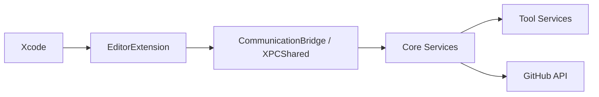

# github/CopilotForXcode

> Xcode extension that brings GitHub Copilot completion, chat and agent mode to Swift developers.

## The problem
Xcode has no native AI code assistant equivalent to those of competing editors.

## What it actually does
Host application plus Xcode editor extension, communicating over XPC with services (Core, Tool) that call the GitHub Copilot APIs. Brings completion (Tab to accept), chat, agent mode (file editing, terminal commands, MCP tools). Requires macOS 13+, Xcode 14+ and a GitHub account; Accessibility and extension permissions.

## How it is wired


## Trying it
```bash
brew install --cask github-copilot-for-xcode
```

## Cost and gotchas
The Copilot service is a GitHub subscription; usage-based billing is coming (v0.50.0+). Three macOS permissions to grant. The README points to a privacy policy, with no telemetry details.

## What it is not
The repository contains the client, not the models; useless without the GitHub service.

## Alternatives
None named in the README.

## For you
Ignore: useful only if you develop in Swift under Xcode, and it depends on a subscription.
