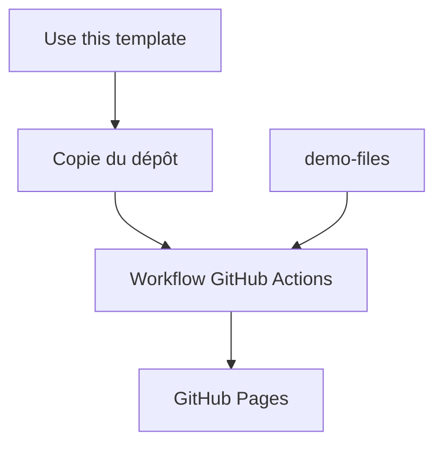

# github/actions-learning-pathway

> Template repository for following the GitHub Actions and GitHub Pages learning modules.

## The problem
A step-by-step tutorial needs a starter web application and workflow files.

## What it actually does
Contains the web application and configuration used by the module "Essentials of automated application deployment with GitHub Actions & GitHub Pages". It is used as a repository template. The `/demo-files` folder is used to follow the intermediate module.

## How it is wired
Simplified diagram based on the sheet, no diagram provided.



## Trying it
```bash
# Aucune commande : cliquer sur « Use this template » puis créer le dépôt en public
```

## Cost and gotchas
Free if the repository is public (private repositories consume Actions minutes). GitHub account required. Archived.

## What it is not
Not a useful application in itself: support for a tutorial, which will no longer be updated.

## Alternatives
None cited in the README.

## For you
Ignore: introductory Actions course, archived; the official documentation is enough for MLOps.
