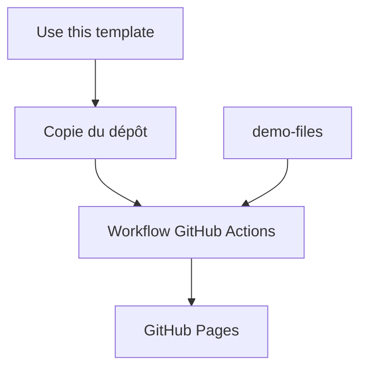

# github/actions-learning-pathway

> Dépôt modèle pour suivre les modules d'apprentissage GitHub Actions et GitHub Pages.

## Le problème
Un tutoriel pas à pas a besoin d'une application web de départ et de fichiers de workflow.

## Ce que ça fait vraiment
Contient l'application web et la configuration utilisées par le module « Essentials of automated application deployment with GitHub Actions & GitHub Pages ». On l'utilise comme modèle de dépôt. Le dossier `/demo-files` sert à suivre le module intermédiaire.

## Comment c'est branché
Schéma simplifié d'après la fiche, sans diagramme fourni.



## Essayer
```bash
# Aucune commande : cliquer sur « Use this template » puis créer le dépôt en public
```

## Coût et pièges
Gratuit si le dépôt est public (les dépôts privés consomment des minutes Actions). Compte GitHub requis. Archivé.

## Ce que ce n'est pas
Pas une application utile en soi : support d'un tutoriel, qui ne sera plus mis à jour.

## Alternatives
Aucune citée dans le README.

## Pour toi
Ignorer : cours d'initiation à Actions, archivé ; la documentation officielle suffit pour du MLOps.

