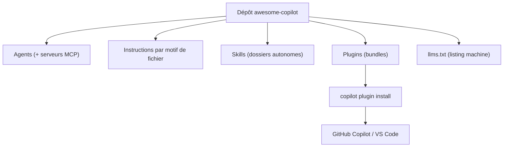

# github/awesome-copilot

> Community collection of agents, instructions, skills, hooks and plugins for GitHub Copilot.

## The problem
Copilot customizations — per-file-pattern instructions, agents, skills — are otherwise shared by screenshot and copy-paste between teams.

## What it actually does
Organizes five families of resources: specialized agents that integrate with MCP servers, instructions applied automatically according to a file pattern, skills as self-contained folders with their resources, plugins bundling agents and skills for a workflow, and a cookbook of ready-to-paste recipes for the Copilot APIs.
The **Awesome Copilot** marketplace is already registered in the CLI and VS Code, and installing a plugin takes a single command. A machine-readable `llms.txt` file lists agents, instructions and skills. A Learning Hub on the site covers hooks, agentic workflows and MCP servers.

## How it is wired


## Trying it
```bash
copilot plugin install <plugin-name>@awesome-copilot
copilot plugin marketplace add github/awesome-copilot
```

## Cost and gotchas
The repository is free; it assumes a GitHub Copilot subscription, hence a dependency on a paid service. The README mentions Microsoft trademarks and their terms of use. No information on how community contributions are reviewed.

## What it is not
It is not a product: it is a catalog, whose actual content is not listed in the README, which points to the site for full-text search. It is not portable: everything targets Copilot. It is not maintained by Microsoft in the sense of support, despite the `github` organization.

## Alternatives
- **wshobson/agents**: multi-environment catalog that also covers Copilot.
- **anthropics/claude-plugins-official**: official equivalent on the Claude Code side.

## For you
Of no interest if you do not use Copilot; per-file-pattern instructions are worth the idea.
