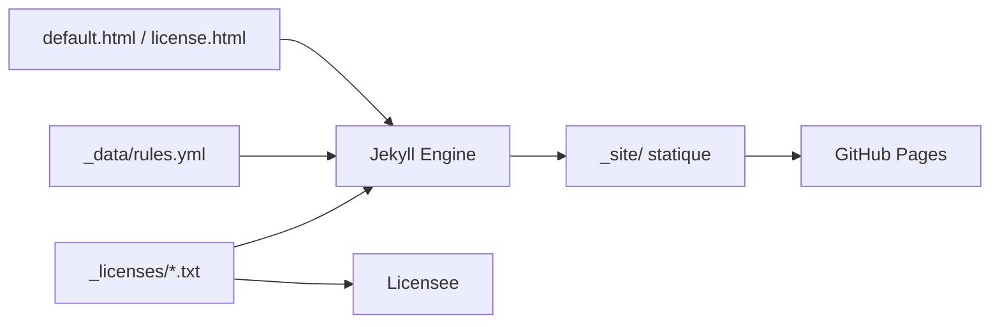

# github/choosealicense.com

> GitHub's Jekyll site that explains popular open source licenses, for those who must pick one.

## The problem
Choosing a license for a project without reading whole legal texts, or getting permissions and obligations wrong.

## What it actually does
License catalog as a Jekyll collection (`_licenses`) with YAML metadata (permissions, conditions, limitations). It generates the site, translates the interface via jekyll-polyglot (legal text is never translated) and serves as the source for Licensee, used by GitHub to detect licenses.

## How it is wired


## Trying it
```bash
git clone https://github.com/github/choosealicense.com.git --recursive
cd choosealicense.com
./script/bootstrap
./script/server
```
Then open `http://localhost:4000`.

## Cost and gotchas
Free. `cmake` and `make` are needed to run it locally. No key or account.

## What it is not
Not legal advice: the authors aim for non-judgmental information. Deliberately not exhaustive: a short list of licenses that matter.

## Alternatives
No alternative named in the README.

## For you
Adopt as a reference for publishing your repositories: it decides without jargon between permissive and copyleft licenses, which avoids a license mistake on a data tool.
