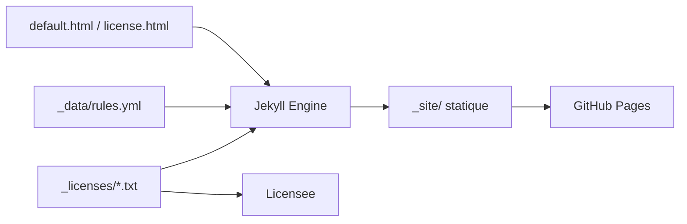

# github/choosealicense.com

> Site Jekyll de GitHub qui explique les licences open source populaires, pour qui doit en choisir une.

## Le problème
Choisir une licence pour un projet sans lire des textes juridiques entiers, ni se tromper sur permissions et obligations.

## Ce que ça fait vraiment
Catalogue de licences en collection Jekyll (`_licenses`) avec métadonnées YAML (permissions, conditions, limitations). Il génère le site, traduit l'interface via jekyll-polyglot (texte légal jamais traduit) et sert de source à Licensee, utilisé par GitHub pour détecter les licences.

## Comment c'est branché


## Essayer
```bash
git clone https://github.com/github/choosealicense.com.git --recursive
cd choosealicense.com
./script/bootstrap
./script/server
```
Puis ouvrir `http://localhost:4000`.

## Coût et pièges
Gratuit. Il faut `cmake` et `make` pour le lancer en local. Aucune clé ni compte.

## Ce que ce n'est pas
Pas un conseil juridique : les auteurs visent l'information non jugeante. Pas exhaustif volontairement : une petite liste de licences qui comptent.

## Alternatives
Aucune alternative nommée dans le README.

## Pour toi
Adopter comme référence pour publier tes dépôts : il tranche sans jargon entre licences permissives et copyleft, ce qui évite une erreur de licence sur un outil data.

