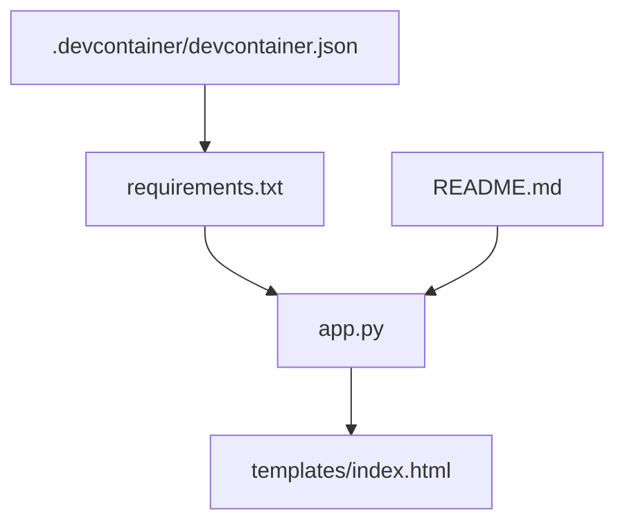

# github/codespaces-flask

> Flask starter template to open in a GitHub Codespace, for beginners.

## The problem
Starting a Flask project requires setting up a local environment.

## What it actually does
A development container installs `requirements.txt`, then `app.py` launches a Flask application that renders `templates/index.html`. Everything happens in the Codespace, with no GitHub repository until you publish the branch.

## How it is wired


## Trying it
```bash
flask --debug run
```

## Cost and gotchas
Free within Codespaces quotas; a GitHub account is required. No license declared.

## What it is not
Not a framework nor an example of a real application: a single page.

## Alternatives
No alternative named in the README.

## For you
Ignore: a trivial Flask skeleton you write yourself in two minutes.
