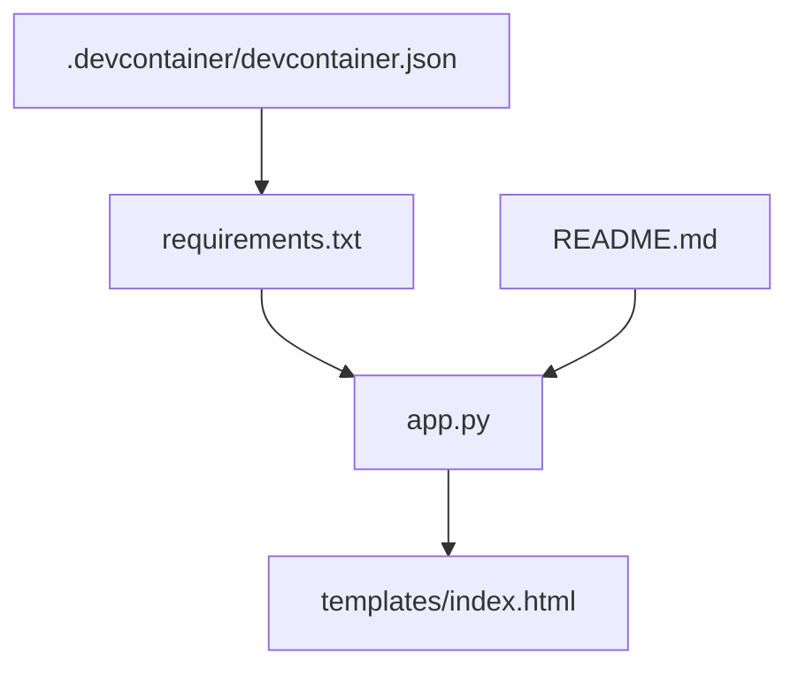

# github/codespaces-flask

> Modèle de départ Flask à ouvrir dans un GitHub Codespace, pour débutants.

## Le problème
Démarrer un projet Flask demande de configurer un environnement local.

## Ce que ça fait vraiment
Un conteneur de développement installe `requirements.txt`, puis `app.py` lance une application Flask qui rend `templates/index.html`. Tout se passe dans le Codespace, sans dépôt GitHub tant qu'on ne publie pas la branche.

## Comment c'est branché


## Essayer
```bash
flask --debug run
```

## Coût et pièges
Gratuit dans les quotas Codespaces ; un compte GitHub est requis. Aucune licence déclarée.

## Ce que ce n'est pas
Pas un cadre ni un exemple d'application réelle : une page unique.

## Alternatives
Aucune alternative nommée dans le README.

## Pour toi
Ignorer : un squelette Flask trivial que tu écris en deux minutes toi-même.

