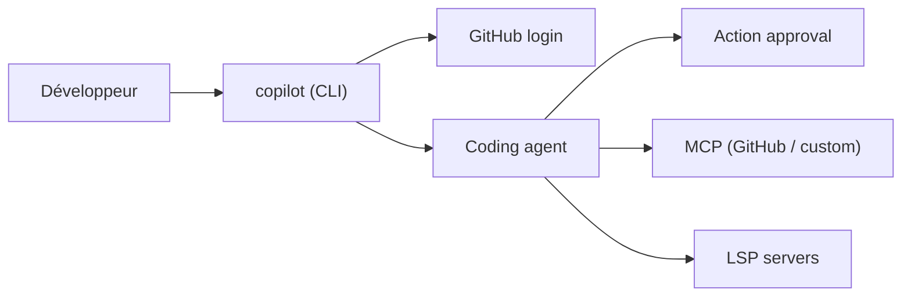

# github/copilot-cli

> GitHub Copilot coding agent in the terminal, which plans and executes tasks under your control.

## The problem
Using an AI assistant forces you to leave the terminal and copy the repository context.

## What it actually does
Run `copilot` in a folder: natural-language conversation, access to repositories, issues and PRs through the GitHub account, GitHub MCP server included and custom MCP servers. Every action is previewed and approved. Experimental "Autopilot" mode, configurable LSP servers (`~/.copilot/lsp-config.json`). The repository contains no application source.

## How it is wired


## Trying it
```bash
npm install -g @github/copilot
copilot
```

## Cost and gotchas
Active Copilot subscription required; each prompt consumes one premium request from the monthly quota. May be disabled by the organization.

## What it is not
The repository serves as documentation and feedback tracking, not as complete open source code. A license is present but not identified.

## Alternatives
No alternative named in the README.

## For you
Worth watching if you already have Copilot: convenient, but paid, tied to GitHub and with no application source to audit.
