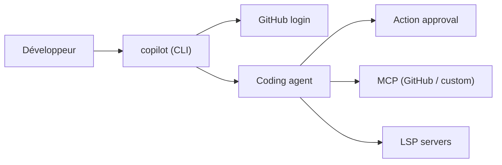

# github/copilot-cli

> Agent de code GitHub Copilot en terminal, qui planifie et exécute des tâches sous ton contrôle.

## Le problème
Utiliser un assistant IA oblige à quitter le terminal et à recopier le contexte du dépôt.

## Ce que ça fait vraiment
Lance `copilot` dans un dossier : conversation en langage naturel, accès aux dépôts, issues et PR via le compte GitHub, serveur MCP GitHub inclus et serveurs MCP personnalisés. Chaque action est prévisualisée et approuvée. Mode expérimental « Autopilot », serveurs LSP configurables (`~/.copilot/lsp-config.json`). Le dépôt ne contient pas de source applicative.

## Comment c'est branché


## Essayer
```bash
npm install -g @github/copilot
copilot
```

## Coût et pièges
Abonnement Copilot actif requis ; chaque prompt consomme une requête premium du quota mensuel. Peut être désactivé par l'organisation.

## Ce que ce n'est pas
Le dépôt sert de documentation et de suivi des retours, non de code source ouvert complet. Licence présente mais non identifiée.

## Alternatives
Aucune alternative nommée dans le README.

## Pour toi
À surveiller si tu as déjà Copilot : pratique, mais payant, lié à GitHub et sans source applicative à auditer.

