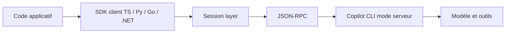

# github/copilot-sdk

> Multi-language SDK to embed the Copilot CLI agent engine in your own applications.

## The problem
Building your own agent orchestration (planning, tools, file editing) is expensive.

## What it actually does
Python, TypeScript, Go, .NET (in this repository), Java and Rust clients talk JSON-RPC to the Copilot CLI launched in server mode. The SDK handles process lifecycle, sessions, custom tools, MCP servers, agents, skills, hooks and permissions. OpenTelemetry telemetry is documented.

## How it is wired


## Trying it
```bash
npm install @github/copilot-sdk
pip install github-copilot-sdk
go get github.com/github/copilot-sdk/go
dotnet add package GitHub.Copilot.SDK
cargo add github-copilot-sdk
```

## Cost and gotchas
Copilot subscription required (limited free tier), except BYOK with your own keys. Each prompt counts against the quota. Go, Java and Rust require installing the CLI separately.

## What it is not
Not a standalone engine: the Copilot CLI is a mandatory external dependency. By default the CLI's tools are exposed as with `--allow-all`: the permission handler is yours to write.

## Alternatives
None named in the README.

## For you
Worth watching: interesting for embedding a coding agent in an internal tool if you are already a Copilot customer, with the vendor lock-in that implies.
