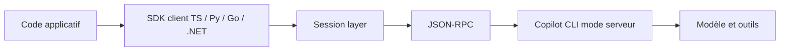

# github/copilot-sdk

> SDK multi-langages pour intégrer le moteur d'agent de Copilot CLI dans ses propres applications.

## Le problème
Construire sa propre orchestration d'agent (planification, outils, édition de fichiers) coûte cher.

## Ce que ça fait vraiment
Des clients Python, TypeScript, Go, .NET (dans ce dépôt), Java et Rust parlent en JSON-RPC à Copilot CLI lancé en mode serveur. Le SDK gère le cycle de vie du processus, les sessions, les outils personnalisés, serveurs MCP, agents, skills, hooks et permissions. La télémétrie OpenTelemetry est documentée.

## Comment c'est branché


## Essayer
```bash
npm install @github/copilot-sdk
pip install github-copilot-sdk
go get github.com/github/copilot-sdk/go
dotnet add package GitHub.Copilot.SDK
cargo add github-copilot-sdk
```

## Coût et pièges
Abonnement Copilot requis (palier gratuit limité), sauf BYOK avec tes propres clés. Chaque prompt compte dans le quota. Go, Java et Rust demandent d'installer le CLI à part.

## Ce que ce n'est pas
Pas un moteur autonome : le CLI Copilot est une dépendance externe obligatoire. Par défaut les outils du CLI sont exposés comme avec `--allow-all` : le gestionnaire de permissions est à écrire.

## Alternatives
Aucune nommée dans le README.

## Pour toi
À surveiller : intéressant pour embarquer un agent de code dans un outil interne si tu es déjà client Copilot, avec le verrou fournisseur que cela implique.

