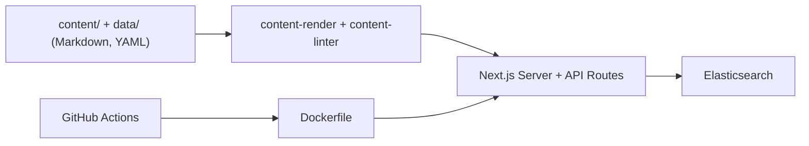

# github/docs

> Open sources of GitHub's documentation, for anyone who wants to fix or complete it.

## The problem
A product's documentation changes constantly; there must be a channel where outsiders can propose corrections.

## What it actually does
The public repo accepts contributions to the Markdown files in `/content` and a few sections of `/data` (reusables). It is synchronized with `github/docs-internal`, which is private and reserved for employees. Infrastructure, workflows and site code are closed to outside contributions. Based on the architecture described, the site is a Next.js application with APIs (article, REST, GraphQL, search), served behind a CDN.

## How it is wired

## Trying it
No command documented in the README; it points to the contribution guides.

## Cost and gotchas
Free. CC-BY-4.0 license. Only content files are open: no point in proposing a fix to the site's code.

## What it is not
Not a tool nor a library: it is content. The README does not describe how to run the site locally.

## Alternatives
No alternative cited in the README (`github/docs-internal` is the private counterpart, not a replacement).

## For you
Ignore: only useful for contributing to GitHub's documentation, with no direct use for a data or AI pipeline.
