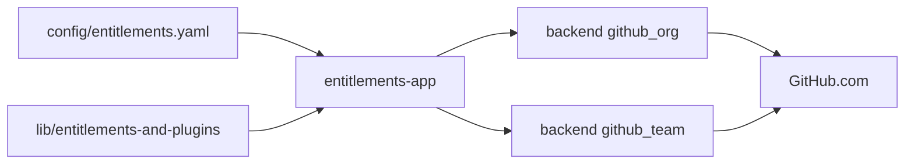

# github/entitlements-github-plugin

> Ruby plugin for entitlements-app that manages GitHub organization and team members from files.

## The problem
Managing GitHub team membership by hand drifts and leaves no verifiable trace.

## What it actually does
Reads `admin.txt` and `member.txt` files for organization roles, and one file per team for teams. Applies these lists on GitHub.com. A `metadata_parent_team_name` metadata field defines the parent team. The token is passed via an environment variable.

## How it is wired
Simplified diagram based on the fiche, no diagram provided.



## Trying it
```bash
# Aucune commande documentée : le README montre des fichiers Ruby/ERB à écrire.
# Release : bundle install
```

## Cost and gotchas
Free. Requires entitlements-app, Ruby (absent from the list) and a GitHub token (`GITHUB_ORG_TOKEN`) with administration rights.

## What it is not
Not a standalone tool: it only works as a plugin of entitlements-app.

## Alternatives
No alternative named in the README.

## For you
Ignore: GitHub rights administration, outside data/AI/MLOps unless you manage a large organization.
