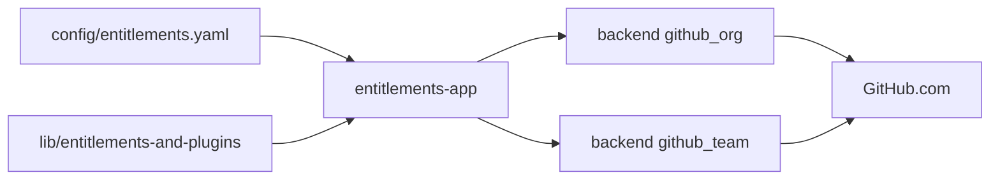

# github/entitlements-github-plugin

> Greffon Ruby pour entitlements-app qui gère les membres d'organisations et d'équipes GitHub depuis des fichiers.

## Le problème
Gérer à la main l'appartenance aux équipes GitHub dérive et ne laisse pas de trace vérifiable.

## Ce que ça fait vraiment
Lit des fichiers `admin.txt` et `member.txt` pour les rôles d'organisation, et un fichier par équipe pour les équipes. Applique ces listes sur GitHub.com. Une métadonnée `metadata_parent_team_name` définit l'équipe parente. Le jeton est passé par variable d'environnement.

## Comment c'est branché
Schéma simplifié d'après la fiche, sans diagramme fourni.



## Essayer
```bash
# Aucune commande documentée : le README montre des fichiers Ruby/ERB à écrire.
# Release : bundle install
```

## Coût et pièges
Gratuit. Exige entitlements-app, Ruby (absent de la liste) et un jeton GitHub (`GITHUB_ORG_TOKEN`) avec droits d'administration.

## Ce que ce n'est pas
Pas un outil autonome : il ne fonctionne qu'en greffon d'entitlements-app.

## Alternatives
Aucune alternative nommée dans le README.

## Pour toi
À ignorer : administration de droits GitHub, hors data/IA/MLOps sauf si tu gères une grande organisation.

