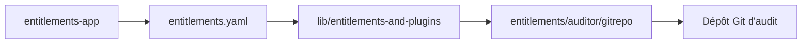

# github/entitlements-gitrepo-auditor-plugin

> Ruby plugin for entitlements-app that writes each deployment log to an audit Git repo.

## The problem
Keeping an auditable trail of each access-rights deployment, outside the tool that applies them.

## What it actually does
At the end of each `entitlements-app` run, the plugin writes a commit to a separate repo with the deployment details. It is loaded via `lib/entitlements-and-plugins` and configured in `config/entitlements.yaml` (ERB), with an SSH key base64-encoded in `GITREPO_SSH_KEY`.

## How it is wired
Simplified diagram based on the sheet, no diagram provided.


## Trying it
```bash
# Aucune commande shell : on require les plugins dans lib/entitlements-and-plugins
# require "entitlements/auditor/gitrepo"
# require "entitlements/util/gitrepo"
```

## Cost and gotchas
Ruby required (not in the list, hence `none`), plus an entitlements-app installation and an audit repo reachable over SSH. The example in the README points to GitHub's internal repos.

## What it is not
Not a standalone tool: useless without entitlements-app. No rights management, only logging.

## Alternatives
None named in the README.

## For you
Ignore: a Ruby audit building block for a rights-management tool, unrelated to a data/AI/MLOps profile.
