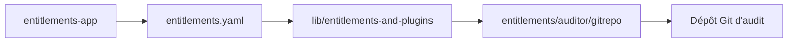

# github/entitlements-gitrepo-auditor-plugin

> Plugin Ruby d'entitlements-app qui écrit chaque journal de déploiement dans un dépôt Git d'audit.

## Le problème
Garder une trace auditable de chaque déploiement de droits d'accès, hors de l'outil qui les applique.

## Ce que ça fait vraiment
À la fin de chaque exécution d'`entitlements-app`, le plugin écrit un commit dans un dépôt séparé avec le détail du déploiement. Il se charge via `lib/entitlements-and-plugins` et se configure dans `config/entitlements.yaml` (ERB), avec une clé SSH encodée en base64 dans `GITREPO_SSH_KEY`.

## Comment c'est branché
Schéma simplifié d'après la fiche, sans diagramme fourni.


## Essayer
```bash
# Aucune commande shell : on require les plugins dans lib/entitlements-and-plugins
# require "entitlements/auditor/gitrepo"
# require "entitlements/util/gitrepo"
```

## Coût et pièges
Ruby requis (hors liste, d'où `aucun`), plus une installation d'entitlements-app et un dépôt d'audit accessible en SSH. Le README en exemple pointe vers des dépôts internes de GitHub.

## Ce que ce n'est pas
Pas un outil autonome : inutile sans entitlements-app. Pas de gestion des droits, seulement de la journalisation.

## Alternatives
Aucune nommée dans le README.

## Pour toi
À ignorer : brique d'audit Ruby pour un outil de gestion de droits, sans rapport avec un profil data/IA/MLOps.

