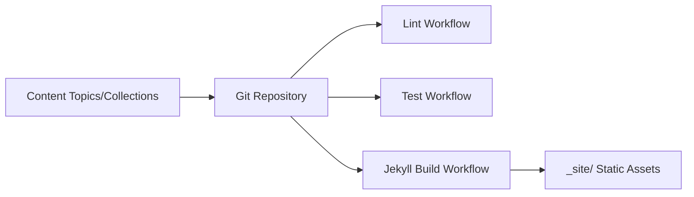

# github/explore

> Community content for GitHub's Topics and Collections pages, for anyone who wants to propose an edit.

## The problem
GitHub's Topics and Collections pages need an open place where they can be edited and reviewed.

## What it actually does
A repository of Markdown files (`topics/`, `collections/`) rendered by Jekyll/Liquid into a static site. Lint tests (rubocop) and GitHub Actions workflows check the format; the build produces `_site/`, published on GitHub Pages. There is no software for a user to run.

## How it is wired


## Trying it
```bash
bundle install
bundle exec rubocop
```

## Cost and gotchas
Free; Ruby and Bundler are required for local tests. Content is under CC-BY-4.0.

## What it is not
It is not a tool or a library: it is the editorial content of a GitHub site.

## Alternatives
No alternative named in the README.

## For you
Ignore it unless you want to fix a topic page: there is nothing to adopt technically.
