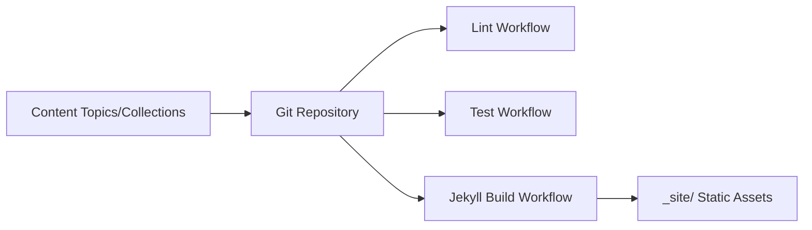

# github/explore

> Contenu communautaire des pages Topics et Collections de GitHub, pour qui veut proposer une édition.

## Le problème
Les pages Topics et Collections de GitHub ont besoin d'un lieu ouvert pour être éditées et relues.

## Ce que ça fait vraiment
Dépôt de fichiers Markdown (`topics/`, `collections/`) rendus par Jekyll/Liquid en site statique. Des tests de lint (rubocop) et workflows GitHub Actions vérifient le format ; le build produit `_site/` publié sur GitHub Pages. Pas de logiciel à exécuter pour un utilisateur.

## Comment c'est branché


## Essayer
```bash
bundle install
bundle exec rubocop
```

## Coût et pièges
Gratuit ; Ruby et Bundler requis pour les tests locaux. Contenu sous CC-BY-4.0.

## Ce que ce n'est pas
Ce n'est pas un outil ni une bibliothèque : c'est le contenu éditorial d'un site GitHub.

## Alternatives
Aucune alternative nommée dans le README.

## Pour toi
À ignorer sauf si tu veux corriger une page de topic : rien à adopter techniquement.

