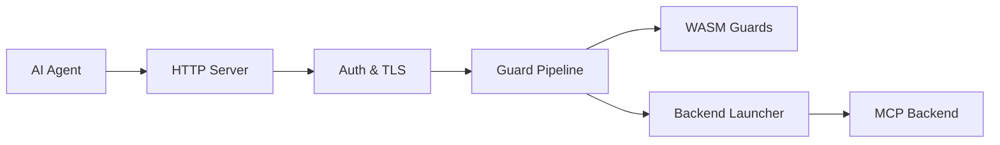

# github/gh-aw-mcpg

> Gateway for MCP servers with guard policies, intended for sandboxed GitHub Agentic Workflows agents.

## The problem
An AI agent calling MCP servers can read or write data it should not: a control point is needed.

## What it actually does
A Go binary (`awmg`) receives JSON-RPC 2.0 and routes to MCP servers launched in Docker (or Podman) containers, in routed mode (`/mcp/{serverID}`) or unified mode (`/mcp`). WASM guards apply integrity and secret rules (allow-only, write-sink) before and after the call. A proxy mode also filters `gh` REST/GraphQL requests. OpenTelemetry tracing, JSONL logs and health endpoints are included.

## How it is wired


## Trying it
```bash
docker pull ghcr.io/github/gh-aw-mcpg:latest
docker run --rm -i \
  -e MCP_GATEWAY_PORT=8000 \
  -e MCP_GATEWAY_DOMAIN=localhost \
  -e MCP_GATEWAY_AGENT_ID=your-agent-id \
  -v /var/run/docker.sock:/var/run/docker.sock \
  -v /path/to/logs:/tmp/gh-aw/mcp-logs \
  -p 8000:8000 \
  ghcr.io/github/gh-aw-mcpg:latest < config.json
```

## Cost and gotchas
The Docker socket is mounted into the container, which is sensitive. A GitHub token is required for the GitHub servers. `/reflect` is unauthenticated: only expose it on a trusted network.

## What it is not
Not a general-purpose security tool: the guards are centered on GitHub. The README notes that the image is to be pulled "when available".

## Alternatives
No alternative named in the README.

## For you
Worth watching: relevant if you deploy agents with MCP servers and want to filter their access, but very tied to the GitHub Actions ecosystem.
