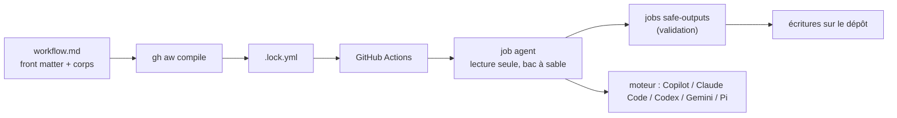

# github/gh-aw

> Defines agent-driven repository automations, written in Markdown compiled to GitHub Actions.

## The problem
Triaging issues, reviewing PRs or investigating a CI failure requires interpretation, which
deterministic scripts cannot provide; plugging an agent into a repository without safeguards
risks uncontrolled writes.

## What it actually does
An agentic workflow has two parts: a YAML front matter (triggers, permissions, tools, AI engine)
and a Markdown body that tells the agent what to accomplish. `gh aw compile` validates this source
and produces the `.lock.yml` that GitHub Actions runs. The built-in engines are GitHub Copilot,
Claude Code, OpenAI Codex, Google Gemini and Pi. The agent job is read-only and sandboxed by
default; configured writes go through separate `safe-outputs` jobs that buffer them, validate them
and apply them with restricted permissions.

## How it is wired


## Trying it
```bash
gh extension install github/gh-aw
go test ./pkg/linters//...
go build ./cmd/linters
make golint-custom
```

## Cost and gotchas
The chosen AI engine consumes tokens billed to your account. A security flaw was found in versions
`>= 0.83.3, < 0.85.4`, which were withdrawn as a precaution: pin a recent version.

## What it is not
Not a CI/CD replacement: the README insists that it complements classic Actions, which remain the
right answer for builds, tests, lint and deployments. Not safe by default despite the safeguards:
the text states plainly that the author must review permissions, tools, network access and
generated files, that human oversight remains necessary and that things can still go wrong.

## Alternatives
- Conventional GitHub Actions: for everything deterministic and reproducible.

## For you
The "read-only agent + safe-outputs" model is worth copying, even outside GitHub.
