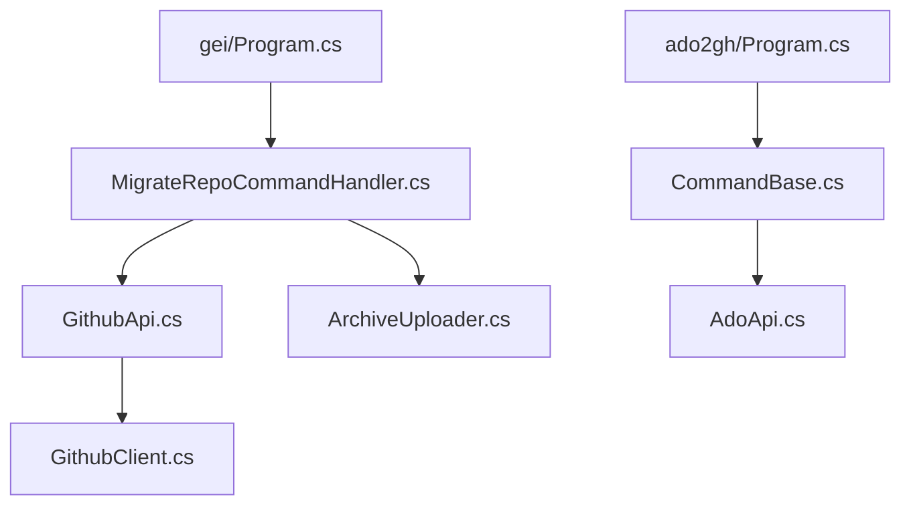

# github/gh-gei

> GitHub CLI extensions to migrate repositories from Azure DevOps, GitLab, Bitbucket or GitHub to GitHub Enterprise Cloud.

## The problem
Moving dozens of repositories to GitHub Enterprise Cloud by hand is slow and risky.

## What it actually does
Four CLIs (`gh gei`, `gh ado2gh`, `gh bbs2gh`, `gh gl2gh`) share the Octoshift library. Their handlers call the GitHub and source APIs, upload the archives, and `generate-script` produces a PowerShell script `migrate.ps1` to review and then run.

## How it is wired


## Trying it
```bash
gh extension install github/gh-gei
gh gei generate-script --github-source-org ORGNAME --github-target-org ORGNAME
gh extension upgrade github/gh-gei
```

## Cost and gotchas
Free, but you need GitHub Enterprise Cloud, personal tokens (`GH_PAT`, `GH_SOURCE_PAT`...) and PowerShell for the generated scripts. Bitbucket is in public beta.

## What it is not
Not a backup or continuous sync tool: it is one-off migration.

## Alternatives
No alternative named in the README.

## For you
Ignore: useful to administrators migrating to GitHub Enterprise, not to your day-to-day data/AI/MLOps work.
