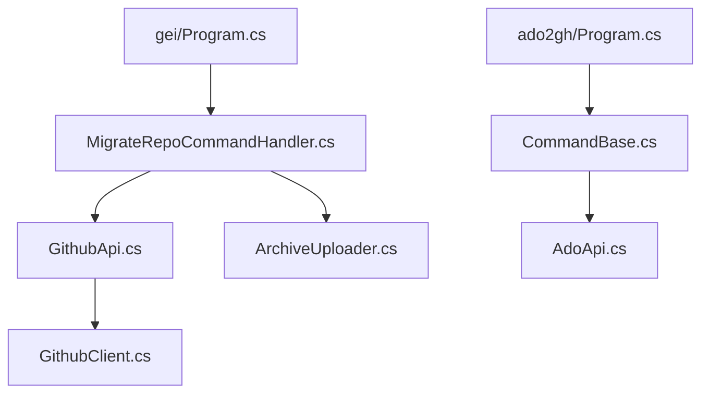

# github/gh-gei

> Extensions du CLI GitHub pour migrer des dépôts d'Azure DevOps, GitLab, Bitbucket ou GitHub vers GitHub Enterprise Cloud.

## Le problème
Déplacer des dizaines de dépôts vers GitHub Enterprise Cloud à la main est long et risqué.

## Ce que ça fait vraiment
Quatre CLI (`gh gei`, `gh ado2gh`, `gh bbs2gh`, `gh gl2gh`) partagent la bibliothèque Octoshift. Leurs gestionnaires appellent les API GitHub et de la source, envoient les archives, et `generate-script` produit un script PowerShell `migrate.ps1` à relire puis exécuter.

## Comment c'est branché


## Essayer
```bash
gh extension install github/gh-gei
gh gei generate-script --github-source-org ORGNAME --github-target-org ORGNAME
gh extension upgrade github/gh-gei
```

## Coût et pièges
Gratuit, mais il faut GitHub Enterprise Cloud, des jetons personnels (`GH_PAT`, `GH_SOURCE_PAT`...) et PowerShell pour les scripts générés. Bitbucket est en bêta publique.

## Ce que ce n'est pas
Pas un outil de sauvegarde ni de synchronisation continue : c'est de la migration ponctuelle.

## Alternatives
Aucune alternative nommée dans le README.

## Pour toi
À ignorer : utile aux administrateurs qui migrent vers GitHub Enterprise, pas à ton travail data/IA/MLOps courant.

