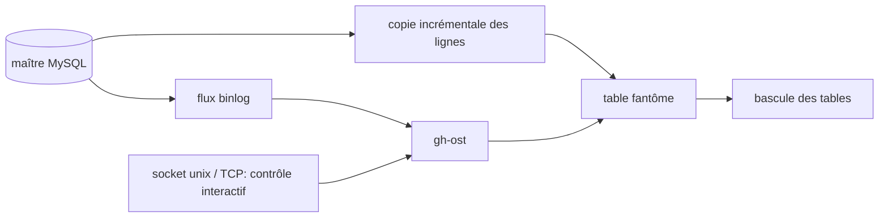

# github/gh-ost

> Online MySQL schema migration, triggerless, controllable and interruptible while it runs.

## The problem
Online schema-change tools rely on triggers, which bring limitations and risks on a master under load.

## What it actually does
Like its competitors, gh-ost creates a ghost table, copies the data into it in increments and propagates
the ongoing writes, then swaps the tables. The difference: it reads the binlog stream instead of
using triggers, and applies the events asynchronously. From this it gets real throttling
(a complete halt of writes on the master), interactive reconfiguration during the
migration, auditing over a unix socket or TCP, and the ability to postpone the cut-over
(`--postpone-cut-over-flag-file`) until a time that suits you. External hooks let you
integrate it into your environment.

## How it is wired


## Trying it
```bash
script/build
./bin/gh-ost
build.sh
```
The invocation modes (noop, `--execute`, `--test-on-replica`, `--exact-rowcount`,
`--postpone-cut-over-flag-file`) are described in the cheatsheet referenced by the README.

## Cost and gotchas
Free. Binlog access is required; replica mode is required if the master uses statement-based
replication (SBR). Built with Go 1.15 and above. The README insists: start with
`--test-on-replica`, then a noop, then `--execute`; `master` is generally stable but only
releases are intended for production.

## What it is not
It is not for PostgreSQL: it is specifically MySQL. Nor is it instantaneous — the
copy remains incremental, gh-ost only changes how concurrent writes are captured.
Dedicated pages cover AWS RDS and Azure Database for MySQL, so managed usage is not
transparent.

## Alternatives
The README cites `pt-online-schema-change` and Facebook's online schema change, from which gh-ost takes its
original name (`gh-osc`) — both work through triggers.

## For you
Outside your daily scope, unless an application MySQL warehouse feeds your pipelines and a
schema migration blocks collection.
