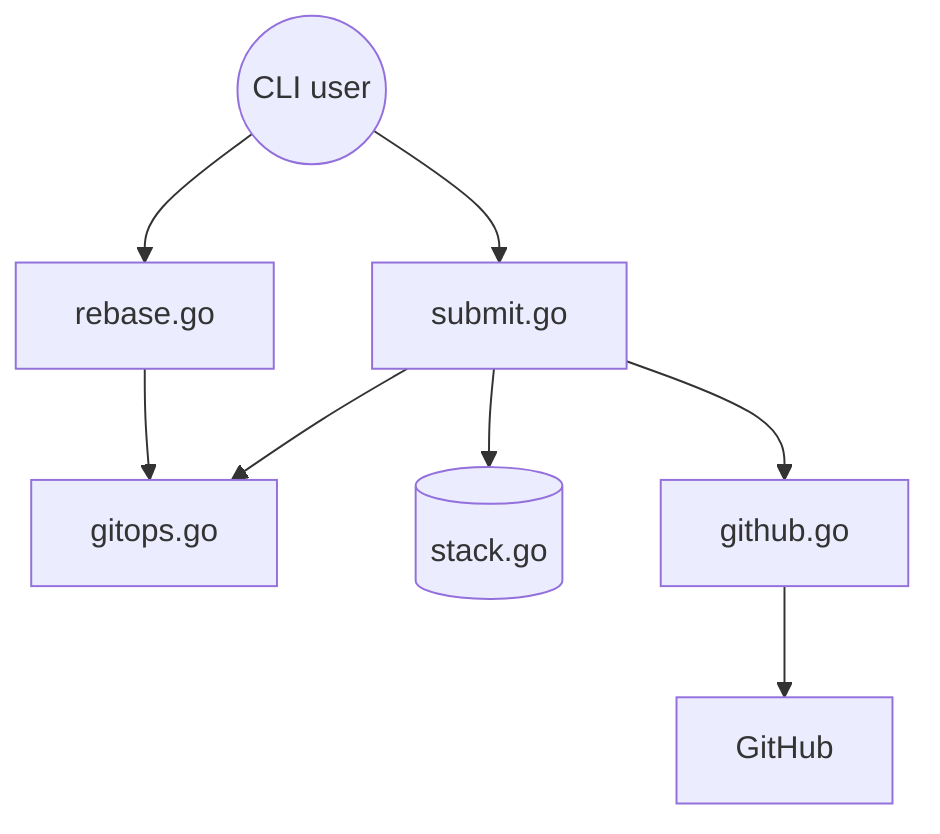

# github/gh-stack

> GitHub CLI extension that manages chains of stacked branches and pull requests, for developers.

## The problem
A big change in a single PR is painful to review. Splitting it into dependent PRs forces you to create, rebase and re-rebase each branch by hand.

## What it actually does
`gh stack` tracks the order of the branches in a stack (metadata in `.git/gh-stack`), rebases them in cascade, pushes with `--force-with-lease`, creates one PR per branch with the right base and links them as a "Stack" on GitHub. It also offers navigation (`up`, `down`, `top`), a reshaping TUI (`modify`), `sync` and an all-or-nothing `merge` of several PRs. A skill for AI agents can be installed via `gh skill install`.

## How it is wired


## Trying it
```bash
gh extension install github/gh-stack
gh stack init
gh stack add api-endpoints
gh stack push
gh stack view
gh stack submit
```

## Cost and gotchas
Free, but requires GitHub CLI v2.0+ and a repository on GitHub. The "Stack" feature lives on the GitHub side: the README does not say which plans it is available on.

## What it is not
Not a standalone git tool: it depends on GitHub and `gh`. A `push` is not atomic (some branches may go through while others fail). The README is truncated in the supplied material; 153 open issues.

## Alternatives
- jj, Sapling, git-town: cited as local branch-management tools, to be combined with `gh stack link`.

## For you
Keep an eye on it: useful if your MLOps team practices stacked PRs on GitHub, otherwise little value for everyday data/AI work.
