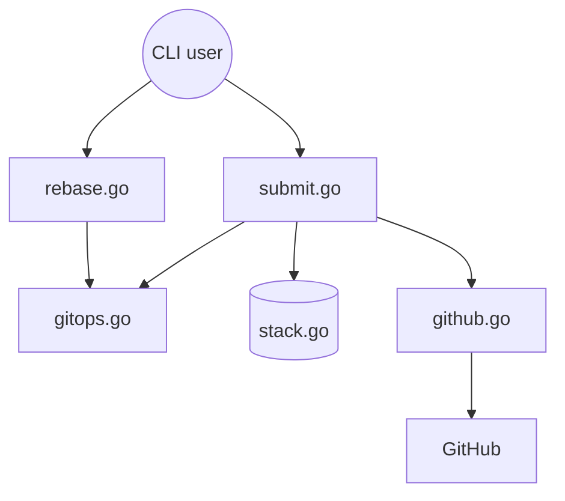

# github/gh-stack

> Extension GitHub CLI qui gère des chaînes de branches et de pull requests empilées, pour développeurs.

## Le problème
Un gros changement en une seule PR est pénible à relire. Découper en PR dépendantes oblige à créer, rebaser et rebaser à la main chaque branche.

## Ce que ça fait vraiment
`gh stack` suit l'ordre des branches d'une pile (métadonnées dans `.git/gh-stack`), les rebase en cascade, pousse avec `--force-with-lease`, crée une PR par branche avec la bonne base et les relie en « Stack » sur GitHub. Il propose aussi navigation (`up`, `down`, `top`), TUI de remodelage (`modify`), `sync` et `merge` de plusieurs PR en tout-ou-rien. Un skill pour agents IA est installable via `gh skill install`.

## Comment c'est branché


## Essayer
```bash
gh extension install github/gh-stack
gh stack init
gh stack add api-endpoints
gh stack push
gh stack view
gh stack submit
```

## Coût et pièges
Gratuit, mais requiert GitHub CLI v2.0+ et un dépôt sur GitHub. La fonction « Stack » est côté GitHub : le README ne précise pas sa disponibilité selon les offres.

## Ce que ce n'est pas
Pas un outil git autonome : il dépend de GitHub et de `gh`. Un `push` n'est pas atomique (certaines branches peuvent passer, d'autres échouer). Le README est tronqué dans la matière fournie ; 153 issues ouvertes.

## Alternatives
- jj, Sapling, git-town : cités comme outils de gestion locale des branches, à combiner avec `gh stack link`.

## Pour toi
Surveiller : utile si ton équipe MLOps pratique des PR empilées sur GitHub, sinon peu de valeur pour un usage data/IA courant.

