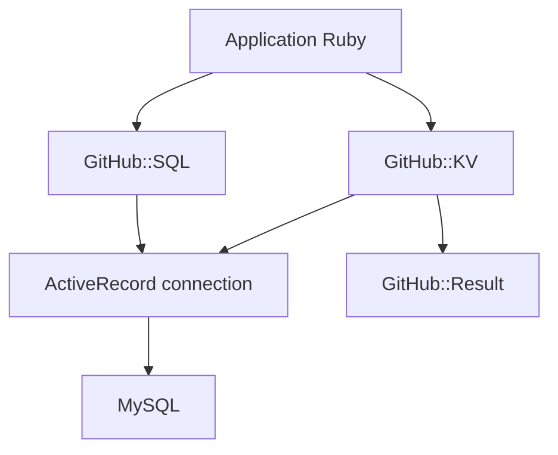

# github/github-ds

> GitHub's Ruby libraries for writing SQL on ActiveRecord: key-value store, queries, Result object.

## The problem
ActiveRecord makes raw SQL queries and value binding awkward, and exceptions complicate resilience.

## What it actually does
`GitHub::KV` is a key-value store on MySQL with expiration. `GitHub::SQL` builds and runs queries with bound values. `GitHub::Result` wraps success or error without raising an exception. Used in production at GitHub.

## How it is wired

Simplified diagram based on the sheet, no diagram provided.

## Trying it
```bash
gem install github-ds
rails generate github:ds:active_record
rails db:migrate
```

## Cost and gotchas
Free. Requires Ruby, Rails and MySQL (not covered by the listed prerequisites). KV keys are case-insensitive, and expired rows are not purged automatically.

## What it is not
Not an analytics data tool nor for Python. Contributions are slow, because every change is checked against GitHub's production.

## Alternatives
No alternative cited in the README.

## For you
Ignore: reserved for Ruby applications on MySQL, far from data, AI or MLOps work.
