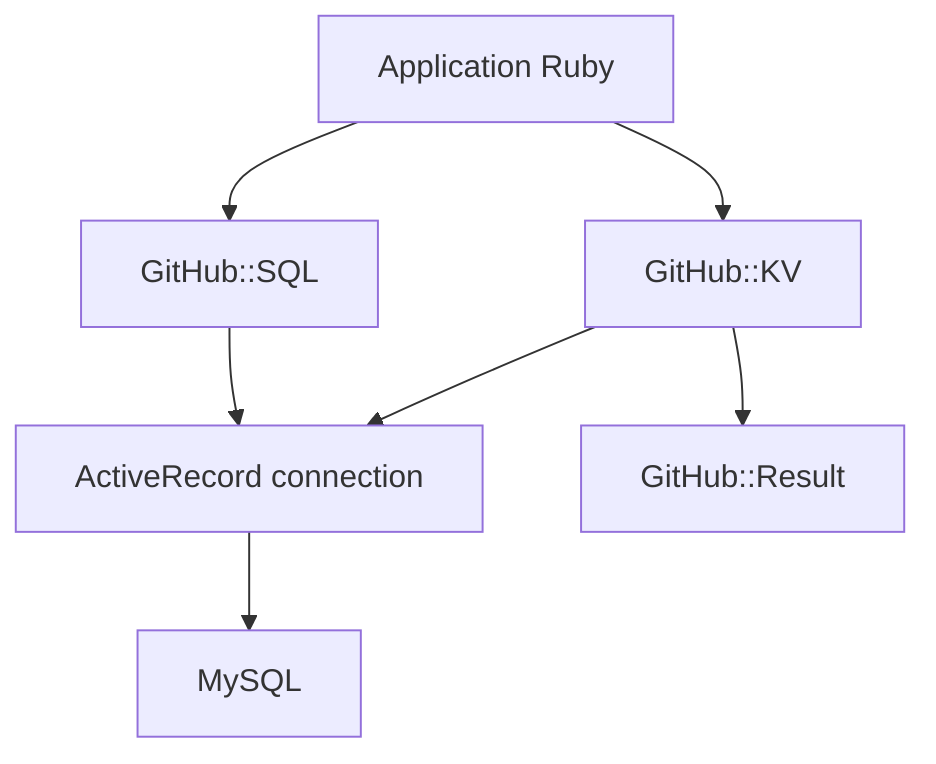

# github/github-ds

> Bibliothèques Ruby de GitHub pour écrire du SQL sur ActiveRecord : stockage clé-valeur, requêtes, objet Result.

## Le problème
ActiveRecord rend les requêtes SQL brutes et les liaisons de valeurs peu pratiques, et les exceptions compliquent la résilience.

## Ce que ça fait vraiment
`GitHub::KV` est un magasin clé-valeur sur MySQL avec expiration. `GitHub::SQL` construit et exécute des requêtes avec valeurs liées. `GitHub::Result` encapsule succès ou erreur sans lever d'exception. Utilisé en production chez GitHub.

## Comment c'est branché

Schéma simplifié d'après la fiche, sans diagramme fourni.

## Essayer
```bash
gem install github-ds
rails generate github:ds:active_record
rails db:migrate
```

## Coût et pièges
Gratuit. Demande Ruby, Rails et MySQL (non couverts par les prérequis listés). Les clés KV sont insensibles à la casse, et les lignes expirées ne sont pas purgées toutes seules.

## Ce que ce n'est pas
Pas un outil de données analytiques ni pour Python. Les contributions sont lentes, car chaque changement est vérifié pour la production de GitHub.

## Alternatives
Aucune alternative citée dans le README.

## Pour toi
À ignorer : réservé aux applications Ruby sur MySQL, loin d'un travail data, IA ou MLOps.

