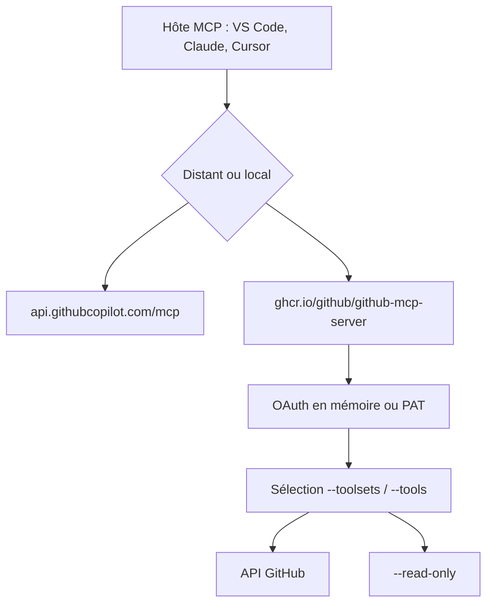

# github/github-mcp-server

> Official MCP server that gives an agent access to GitHub repositories, issues, PRs and Actions.

## The problem
An agent that has to read a repository, triage an issue or analyze a CI failure must reinvent a GitHub client every time.
Each MCP host has its own configuration syntax, scopes and token handling.

## What it actually does
Connects AI tools to GitHub: code browsing, file search, commit analysis, creating and updating issues and PRs, tracking Actions runs, security and Dependabot alerts, discussions and notifications.
Two modes: a remote server hosted by GitHub (`https://api.githubcopilot.com/mcp/`, OAuth or PAT) or a local server as the Docker image `ghcr.io/github/github-mcp-server`, with in-memory OAuth login or `GITHUB_PERSONAL_ACCESS_TOKEN`.
The tool surface can be finely tuned: `--toolsets` (repos, issues, pull_requests, actions, code_security, governance, projects…), `--tools` for individual tools, `all` and `default` as special sets, `--read-only` taking priority over everything.
Supports GitHub Enterprise Cloud with data residency (`ghe.com`) and GitHub Enterprise Server via `--gh-host` or `GITHUB_HOST`, HTTPS enforced.

## How it is wired


## Trying it
```bash
claude mcp add github -e GITHUB_PERSONAL_ACCESS_TOKEN=$GITHUB_PAT -- docker run -i --rm -e GITHUB_PERSONAL_ACCESS_TOKEN ghcr.io/github/github-mcp-server
```

```bash
docker run -i --rm -e GITHUB_PERSONAL_ACCESS_TOKEN=<your-token> -e GITHUB_TOOLSETS="repos,issues,pull_requests,actions,code_security" ghcr.io/github/github-mcp-server
```

## Cost and gotchas
Free; the cost is the scope of the token. The README recommends minimal scopes (`repo`, `read:packages`, `read:org`), separate PATs per project and regular rotation.
GitHub Enterprise Server does not support the remote server; you need the local one. Environment variable support varies by host, some requiring the token hard-coded in a configuration file.

## What it is not
It is not a sandbox: the write tools really act on your repositories unless `--read-only` is set.
It is not uniform across hosts: the syntax, the process and the stability of the integration vary, the README says so.
Insiders mode exposes experimental tools: not for stable use; the README provided is truncated in the middle of the tool list.

## Alternatives
No alternative is named in the README.

## For you
Plug it in with `--read-only` and a restricted set of toolsets: the gain of an agent that actually reads your PRs is immediate.
