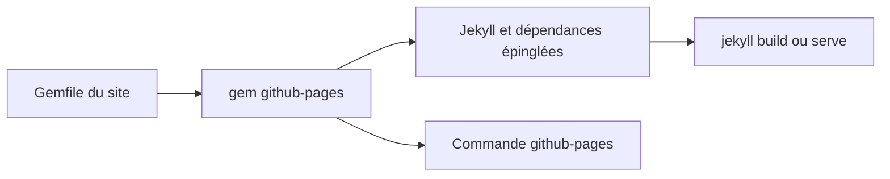

# github/pages-gem

> A Ruby gem that installs locally the same version of Jekyll and its dependencies as GitHub Pages.

## The problem
A Jekyll site builds differently locally than on GitHub Pages servers when Ruby and dependency versions differ.

## What it actually does
The gem pins Jekyll and its dependencies (kramdown, liquid and others) to the production versions. It provides the `github-pages` command with `versions` and `health-check` (DNS diagnostic), a Docker image to preview a site, and a workaround for the plugin whitelist locally.

## How it is wired
Simplified diagram based on the card, no diagram provided.



## Trying it
```bash
bundle install
bundle exec github-pages versions
github-pages health-check
make image
```

## Cost and gotchas
Free. Requires Bundler newer than 1.14 and, for the container route, Docker.

## What it is not
Not a site generator: it is a set of pinned versions. `DISABLE_WHITELIST=true` only works locally, not on GitHub Pages.

## Alternatives
No alternative named in the README.

## For you
Ignore, unless you publish documentation on GitHub Pages with Jekyll: nothing here concerns data or AI.
