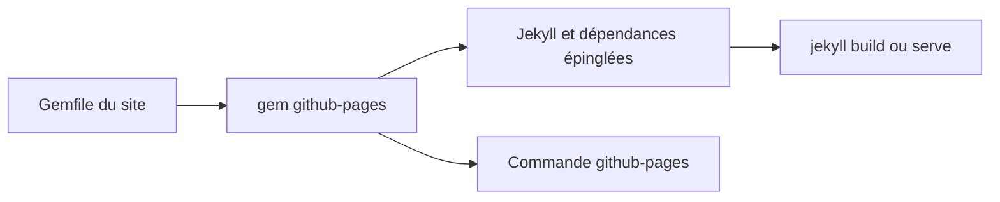

# github/pages-gem

> Une gem Ruby qui installe en local la même version de Jekyll et ses dépendances que GitHub Pages.

## Le problème
Un site Jekyll se construit autrement en local que sur les serveurs de GitHub Pages quand les versions de Ruby et des dépendances diffèrent.

## Ce que ça fait vraiment
La gem épingle Jekyll et ses dépendances (kramdown, liquid et d'autres) sur les versions de la production. Elle fournit la commande `github-pages` avec `versions` et `health-check` (diagnostic DNS), une image Docker pour prévisualiser un site, et un contournement de la liste blanche des plugins en local.

## Comment c'est branché
Schéma simplifié d'après la fiche, sans diagramme fourni.



## Essayer
```bash
bundle install
bundle exec github-pages versions
github-pages health-check
make image
```

## Coût et pièges
Gratuit. Il faut Bundler plus récent que la 1.14 et, pour la voie conteneur, Docker.

## Ce que ce n'est pas
Pas un générateur de sites : c'est un jeu de versions épinglées. `DISABLE_WHITELIST=true` ne marche qu'en local, pas sur GitHub Pages.

## Alternatives
Aucune alternative nommée dans le README.

## Pour toi
À ignorer, sauf si tu publies de la documentation sur GitHub Pages avec Jekyll : rien n'y concerne la donnée ou l'IA.

