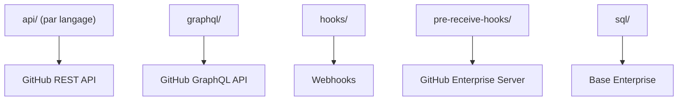

# github/platform-samples

> Official code samples for GitHub's API, GraphQL, webhooks and hooks, for integration developers.

## The problem
Writing a GitHub integration requires concrete examples in your own language.

## What it actually does
A repository of independent sample projects: REST API per language (bash, Go, Groovy, Java, JavaScript, PowerShell, Python, Ruby, Scala), GraphQL queries, webhook consumers, pre-receive hooks for GitHub Enterprise, maintenance scripts, SQL reports for Enterprise Server and Microsoft Graph examples (EMU, OIDC).

## How it is wired

## Trying it
No command documented in the README: each subfolder is self-contained with its own documentation.

## Cost and gotchas
Free, public domain (CC0). Samples are not maintained like a product; some target GitHub Enterprise Server, which is paid.

## What it is not
Not an installable library: examples to copy and adapt. Not up-to-date API documentation.

## Alternatives
No alternative named in the README (it refers to developer.github.com).

## For you
Ignore: occasionally useful for automating GitHub (webhooks, scripts), with no watch value for your field.
