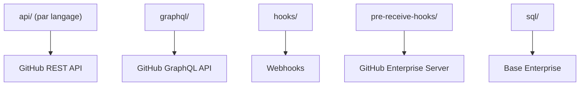

# github/platform-samples

> Exemples de code officiels pour l'API, GraphQL, webhooks et hooks de GitHub, pour développeurs d'intégrations.

## Le problème
Écrire une intégration GitHub demande des exemples concrets dans son propre langage.

## Ce que ça fait vraiment
Dépôt de projets d'exemple indépendants : API REST par langage (bash, Go, Groovy, Java, JavaScript, PowerShell, Python, Ruby, Scala), requêtes GraphQL, consommateurs de webhooks, hooks pre-receive pour GitHub Enterprise, scripts de maintenance, rapports SQL pour Enterprise Server et exemples Microsoft Graph (EMU, OIDC).

## Comment c'est branché

## Essayer
Aucune commande documentée dans le README : chaque sous-dossier est autonome avec sa propre documentation.

## Coût et pièges
Gratuit, domaine public (CC0). Exemples non maintenus comme un produit ; certains ciblent GitHub Enterprise Server, qui est payant.

## Ce que ce n'est pas
Pas une bibliothèque installable : des exemples à copier et adapter. Pas une documentation à jour de l'API.

## Alternatives
Aucune alternative nommée dans le README (renvoi vers developer.github.com).

## Pour toi
À ignorer : utile ponctuellement pour automatiser GitHub (webhooks, scripts), sans valeur de veille pour ton métier.

