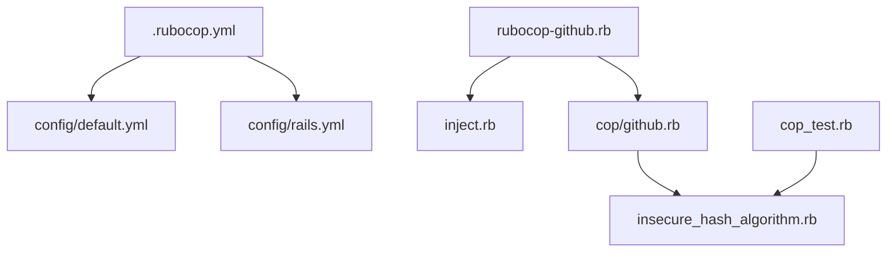

# github/rubocop-github

> RuboCop configuration and extra rules from GitHub's Ruby style guide, for Ruby and Rails projects.

## The problem
Apply a consistent Ruby style and a few security checks without writing the whole configuration.

## What it actually does
Provides `config/default.yml` and `config/rails.yml` to inherit from, and custom rules under `lib/rubocop/cop/github`, for example for unsafe hashing algorithms. The accessibility rules have been moved to another gem.

## How it is wired


## Trying it
```bash
bundle install
bundle exec rake test
```

## Cost and gotchas
Free. Requires Ruby and RuboCop 1.0 or later; for an earlier version, use rubocop-github 0.16.2. Ruby is not in the prerequisites list.

## What it is not
Not a standalone linter: it complements RuboCop.

## Alternatives
No alternative named in the README.

## For you
Ignore: Ruby style, outside the Python and AI of your profile.
