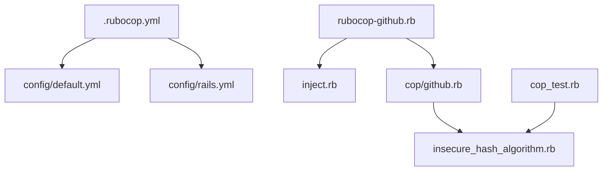

# github/rubocop-github

> Configuration RuboCop et règles supplémentaires du guide de style Ruby de GitHub, pour projets Ruby et Rails.

## Le problème
Appliquer un style Ruby cohérent et quelques contrôles de sécurité sans écrire toute la configuration.

## Ce que ça fait vraiment
Fournit `config/default.yml` et `config/rails.yml` à hériter, et des règles personnalisées sous `lib/rubocop/cop/github`, par exemple pour les algorithmes de hachage non sûrs. Les règles d'accessibilité ont été déplacées dans une autre gemme.

## Comment c'est branché


## Essayer
```bash
bundle install
bundle exec rake test
```

## Coût et pièges
Gratuit. Il faut Ruby et RuboCop 1.0 ou plus ; pour une version antérieure, utiliser rubocop-github 0.16.2. Ruby n'existe pas dans la liste des prérequis.

## Ce que ce n'est pas
Pas un linter autonome : il complète RuboCop.

## Alternatives
Aucune alternative nommée dans le README.

## Pour toi
À ignorer : style Ruby, hors du Python et de l'IA de ton profil.

