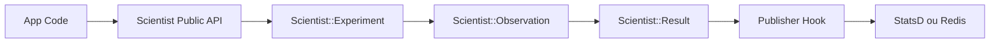

# github/scientist

> Ruby library that compares old and new code in production to refactor without risk.

## The problem
Tests are not enough to guarantee that a rewritten critical path behaves like the old one under real load.

## What it actually does
You wrap the old behavior in `use` and the new one in `try`. `experiment.run` always returns the control's result, randomizes the order, measures wall-clock and CPU time, compares the values and publishes the result to the tool of your choice (StatsD, Redis). Intended for methods that do not modify data.

## How it is wired


## Trying it
```ruby
require "scientist"

class MyWidget
  include Scientist

  def allows?(user)
    science "widget-permissions" do |experiment|
      experiment.use { model.check_user(user).valid? } # old way
      experiment.try { user.can?(:read, model) } # new way
    end
  end
end
```

## Cost and gotchas
Free, Ruby 2.3 or later. Publishing must be written yourself, and the library does not protect against candidate timeouts.

## What it is not
It is not an A/B testing or data science tool. It is dangerous on code that writes data.

## Alternatives
- joealcorn/laboratory: Python version of the same principle.
- trello/scientist: Node.js version.

## For you
Ignore: Ruby library, outside your stack; only the idea of comparing old and new paths (shadow testing of models) is transferable.
