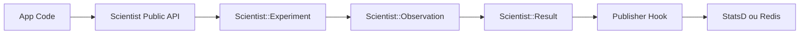

# github/scientist

> Bibliothèque Ruby qui compare ancien et nouveau code en production pour refactorer sans risque.

## Le problème
Les tests ne suffisent pas à garantir qu'un chemin critique réécrit se comporte comme l'ancien sous charge réelle.

## Ce que ça fait vraiment
On enveloppe l'ancien comportement dans `use` et le nouveau dans `try`. `experiment.run` renvoie toujours le résultat du contrôle, tire l'ordre au hasard, mesure temps mur et CPU, compare les valeurs et publie le résultat vers l'outil choisi (StatsD, Redis). Prévu pour des méthodes qui ne modifient pas de données.

## Comment c'est branché


## Essayer
```ruby
require "scientist"

class MyWidget
  include Scientist

  def allows?(user)
    science "widget-permissions" do |experiment|
      experiment.use { model.check_user(user).valid? } # old way
      experiment.try { user.can?(:read, model) } # new way
    end
  end
end
```

## Coût et pièges
Gratuit, Ruby 2.3 ou plus. La publication est à écrire soi-même, et la bibliothèque ne protège pas des délais d'attente du candidat.

## Ce que ce n'est pas
Ce n'est pas un outil de test A/B ni de data science. Il est dangereux sur du code qui écrit des données.

## Alternatives
- joealcorn/laboratory : version Python du même principe.
- trello/scientist : version Node.js.

## Pour toi
À ignorer : bibliothèque Ruby, hors de ta pile ; seule l'idée de comparer ancien et nouveau chemin (shadow testing de modèles) est transposable.

