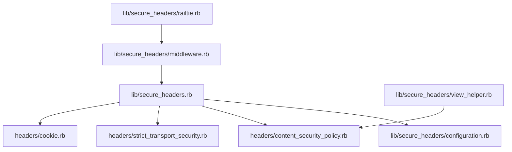

# github/secure_headers

> Ruby gem that automatically applies HTTP security headers (CSP, HSTS, cookies) to Rack and Rails applications.

## The problem
Forgetting a security header or badly writing a CSP policy leaves a web application exposed to XSS, clickjacking and content sniffing.

## What it actually does
A global configuration defines CSP, HSTS, X-Frame-Options, Referrer-Policy and cookie attributes (Secure, HttpOnly, SameSite). A Rack middleware applies these headers to every response, installed by the railtie. Overrides per action or by name (for example for an API) exist, as well as view helpers for nonces and hashes of inline scripts.

## How it is wired

## Trying it
No shell command documented: usage goes through a `SecureHeaders::Configuration.default do |config| ... end` block in a Ruby initializer. Without a default configuration, an exception is raised; `SecureHeaders::Configuration.default` with no argument gives a locked-down base.

## Cost and gotchas
Free. The README example is not a recommended configuration: it must be adapted. The choice between default and disable! is final at startup (AlreadyConfiguredError otherwise).

## What it is not
Not a web application firewall nor a scanner: it sets headers. It does not fix vulnerable code. The main branch is the 7.x line, fixes still go into 6.x.

## Alternatives
- helmet (Node.js, Express): same role if your stack is JavaScript.
- django-csp (Python): equivalent for Django.
- secure-headers (PHP): PHP equivalent.

## For you
Ignore: it is only useful if you serve a Ruby/Rails application; for a Python model API, the README alternatives are closer.
