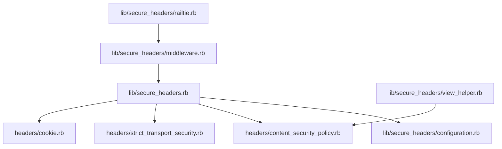

# github/secure_headers

> Gem Ruby qui applique automatiquement les en-têtes HTTP de sécurité (CSP, HSTS, cookies) aux applications Rack et Rails.

## Le problème
Oublier un en-tête de sécurité ou mal écrire une politique CSP laisse une application web exposée au XSS, au clickjacking et au sniffing de contenu.

## Ce que ça fait vraiment
Une configuration globale définit CSP, HSTS, X-Frame-Options, Referrer-Policy et les attributs des cookies (Secure, HttpOnly, SameSite). Un middleware Rack applique ces en-têtes à chaque réponse, installé par le railtie. Des surcharges par action ou par nom (par exemple pour une API) existent, ainsi que des helpers de vue pour nonces et hash des scripts inline.

## Comment c'est branché

## Essayer
Aucune commande shell documentée : l'usage passe par un bloc `SecureHeaders::Configuration.default do |config| ... end` dans un initialiseur Ruby. Sans configuration par défaut, une exception est levée ; `SecureHeaders::Configuration.default` sans argument donne une base verrouillée.

## Coût et pièges
Gratuit. L'exemple du README n'est pas une configuration recommandée : il faut l'adapter. Le choix entre default et disable! est définitif au démarrage (AlreadyConfiguredError sinon).

## Ce que ce n'est pas
Pas un pare-feu applicatif ni un scanner : il pose des en-têtes. Il ne corrige pas un code vulnérable. La branche main est la ligne 7.x, les correctifs vont encore dans 6.x.

## Alternatives
- helmet (Node.js, Express) : même rôle si ta pile est JavaScript.
- django-csp (Python) : équivalent côté Django.
- secure-headers (PHP) : équivalent PHP.

## Pour toi
Ignorer : c'est utile uniquement si tu sers une application Ruby/Rails ; pour une API de modèle en Python, les alternatives du README sont plus proches.

