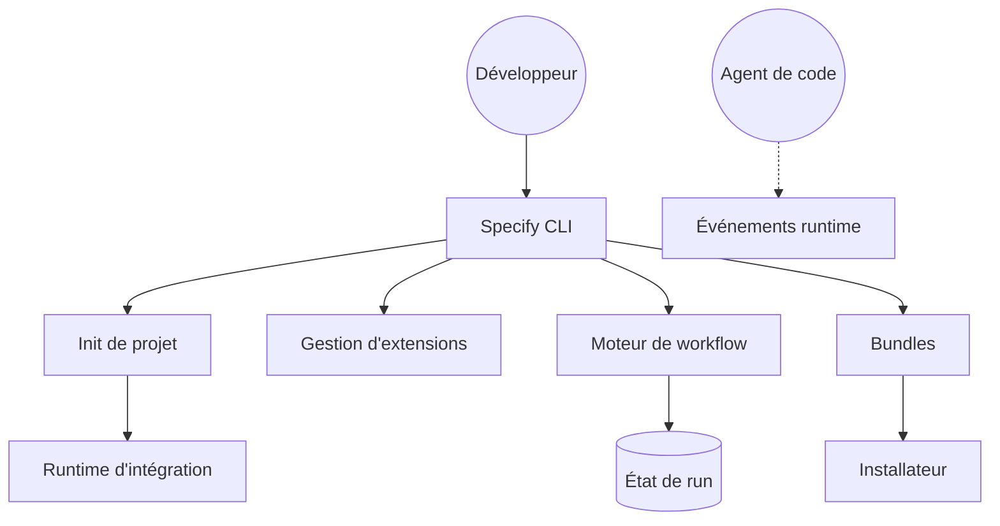

# github/spec-kit

> A command-line interface (CLI) that installs pre-defined processes for code agents, with GitHub signing.

## The problem
An agent tasked with "adding this feature" bypasses the specifications and improvises.
There is no record of what was decided or what was verified.

## What it actually does
Three independent processes: specification-driven development, bug fixing, and idea evaluation.

The first process follows the sequence: specification → implementation → plan → tasks → implementation → convergence, focusing on the skills of the agent.
The second process separates diagnosis, correction, and verification, and produces a verdict of "verified", "partial", or "failed".
The third process produces a decision of "go", "needs clarification", or "kill" within the ".specify/assessments/" directory.

## How it is wired


## Trying it
```bash
uv tool install specify-cli
specify init my-project --integration copilot
specify extension add bug
specify extension add assess
```

## Cost and gotchas
Free. Requires Python 3.11+ and `uv`, plus a supported code agent (e.g., Copilot).
The `/speckit-*` commands are intended to be used within the agent's chat interface, not as terminal commands.

## What it is not
Not a guarantee of quality: artifacts are produced by the same model that codes.
Not a project management tool – there is no connection between specifications and a backlog or CI.
The three processes do not form a single method; they are separate entry points.

## Alternatives
- `addyosmani/agent-skills`: Same goal, but with a larger and less prescriptive catalog.
- `affaan-m/ECC`: Similar loop/test/review process, but with significantly more surface area.

## For you
The "spec before code" approach is recommended for all data projects; the tool is still relatively new. Keep an eye on its development.
