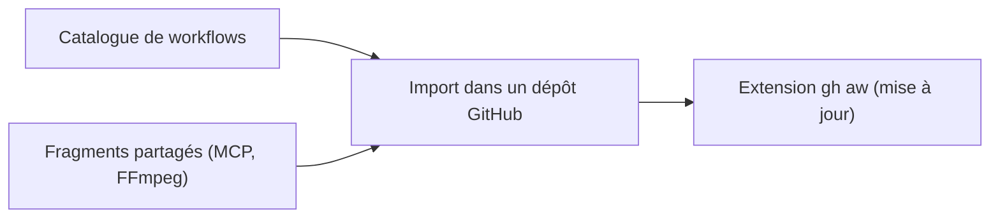

# githubnext/agentics

> Collection of reusable GitHub agentic workflows (triage, CI, review, docs), for repository maintainers.

## The problem
Automating issue triage, CI analysis, code review and documentation requires writing agent-driven workflows yourself.

## What it actually does
- Catalog of ready-to-add workflows: Issue Triage, Repo Assist, CI Doctor, Grumpy Reviewer, Daily Test Improver, etc.
- Some are triggered by `/` commands (Archie, Plan, PR Fix, Repo Ask).
- Security (Daily Malicious Code Scan, VEX Generator) and Lean 4 formal verification (Lean Squad).
- Shared fragments (MCP servers arXiv, MarkItDown, Microsoft Docs; FFmpeg; sq).

## How it is wired
Simplified diagram based on the sheet, no diagram provided.

No diagram provided. The README only describes: workflows imported into a repository, updated by the `gh aw` extension. The internal workings are not documented.

## Trying it
```bash
gh extensions upgrade github/gh-aw
gh aw upgrade
gh aw update
```
These are the update commands; installing a workflow is not detailed in the README.

## Cost and gotchas
Relies on gh-aw and GitHub; the Cost Tracker suggests token spending per run, not quantified. Billing and agent engine not specified.

## What it is not
Not a single product: a sample of templates. The workflows act on your repository (PRs, issues, comments): review them before enabling.

## Alternatives
None named in the README (points to the companion collection Agentics Beyond Code for non-engineers).

## For you
Worth watching: a good source of workflow ideas for an MLOps repository, but dependent on GitHub and on token cost.
