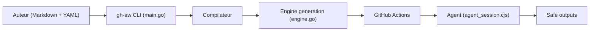

# githubnext/gh-aw

> GitHub CLI extension that compiles AI agent workflows written in Markdown into GitHub Actions.

## The problem
Tasks that require interpretation (issue triage, PR review, investigating a CI failure) do not fit into deterministic Actions scripts.

## What it actually does
- A workflow = YAML frontmatter (triggers, permissions, tools, AI engine) + a Markdown body describing the mission.
- `gh aw compile` validates and generates the `.lock.yml` file run by GitHub Actions.
- Built-in engines: GitHub Copilot, Claude Code, OpenAI Codex, Google Gemini, Pi.
- The agent job is read-only and sandboxed; writes go through validated "safe-outputs" jobs with reduced permissions.

## How it is wired


## Trying it
```bash
gh extension install github/gh-aw
gh aw compile
```

## Cost and gotchas
You must authenticate an AI engine (subscription or key, at your expense) and use GitHub Actions minutes. A vulnerability led to versions >= 0.83.3 and < 0.85.4 being withdrawn. The README asks for careful human supervision and speaks of "use at your own risk".

## What it is not
Does not replace classic CI: for deterministic builds, tests and deployments, keep Actions. The protections are configurable, so review them workflow by workflow.

## Alternatives
No alternative named in the README.

## For you
Worth watching: a serious approach (sandbox, validated outputs) to automate repo MLOps, but young, with a recent security advisory; wait for it to stabilize.
