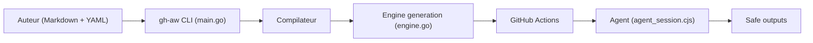

# githubnext/gh-aw

> Extension de la CLI GitHub qui compile des workflows d'agents IA écrits en Markdown vers GitHub Actions.

## Le problème
Les tâches qui demandent de l'interprétation (tri d'issues, revue de PR, enquête sur un échec CI) ne rentrent pas dans des scripts Actions déterministes.

## Ce que ça fait vraiment
- Un workflow = frontmatter YAML (déclencheurs, permissions, outils, moteur IA) + corps Markdown qui décrit la mission.
- `gh aw compile` valide et génère le fichier `.lock.yml` exécuté par GitHub Actions.
- Moteurs intégrés : GitHub Copilot, Claude Code, OpenAI Codex, Google Gemini, Pi.
- Le job agent est en lecture seule et sandboxé ; les écritures passent par des jobs « safe-outputs » validés avec permissions réduites.

## Comment c'est branché


## Essayer
```bash
gh extension install github/gh-aw
gh aw compile
```

## Coût et pièges
Il faut authentifier un moteur IA (abonnement ou clé, à ta charge) et des minutes GitHub Actions. Une faille a fait retirer les versions >= 0.83.3 et < 0.85.4. Le README demande une supervision humaine attentive et parle d'« usage à tes risques ».

## Ce que ce n'est pas
Ne remplace pas la CI classique : pour les builds, tests et déploiements déterministes, on garde Actions. Les protections sont configurables, donc à relire workflow par workflow.

## Alternatives
Aucune alternative nommée dans le README.

## Pour toi
À surveiller : approche sérieuse (sandbox, sorties validées) pour automatiser du MLOps de dépôt, mais jeune, avec un avis de sécurité récent ; attends qu'elle se stabilise.

