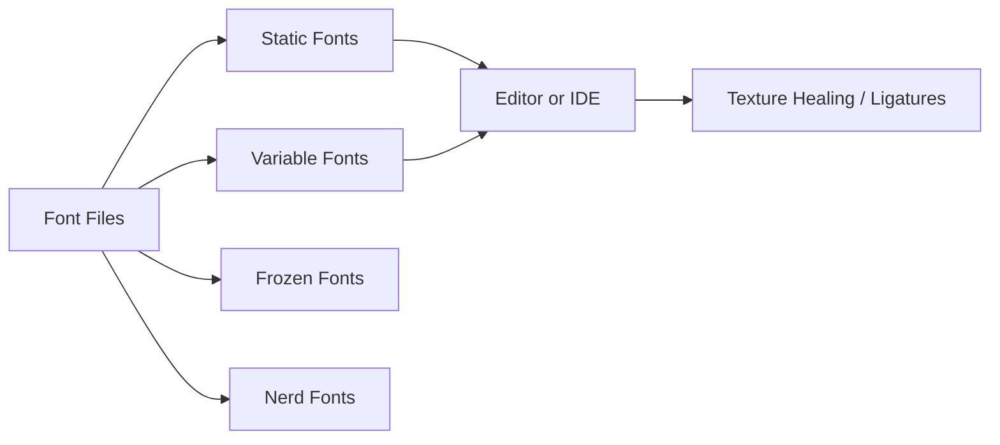

# githubnext/monaspace

> Five mutually compatible monospaced fonts for coding, with ligatures and "texture healing".

## The problem
A single monospace font makes code look uniform and tiring to read; few let you mix typographic voices without breaking alignment.

## What it actually does
Five families (Neon, Argon, Xenon, Radon, Krypton) with identical metrics, in static, variable, Nerd Fonts and "Frozen" formats. OpenType features (`calt` for texture healing, `liga`, `ss01`–`ss10`, `cvNN`) are enabled in the editor. The Frozen version bakes them in for IDEs that do not expose these settings.

## How it is wired


## Trying it
```bash
bash util/install_macos.sh
brew install --cask font-monaspace
fc-cache -f
```
VS Code: `"editor.fontFamily": "'Monaspace Neon', monospace"` and `"editor.fontLigatures": "'calt', 'liga', 'ss01'…"`.

## Cost and gotchas
Free. After an update, you must delete the old fonts, reinstall, and restart applications (sometimes the machine). Ligature behavior changed between minor versions.

## What it is not
Not a software tool: nothing runs, no service. VS Code does not handle variable fonts or font-family mixing well (README). Some Nerd Fonts icons may render badly depending on the terminal.

## Alternatives
No alternative named in the README (Cascadia Code is only cited as the basis of the Nerd Fonts icons).

## For you
Useful for code reading comfort in the editor, unrelated to data/AI work: ignore as a watch topic, install it if you like ligatures.
