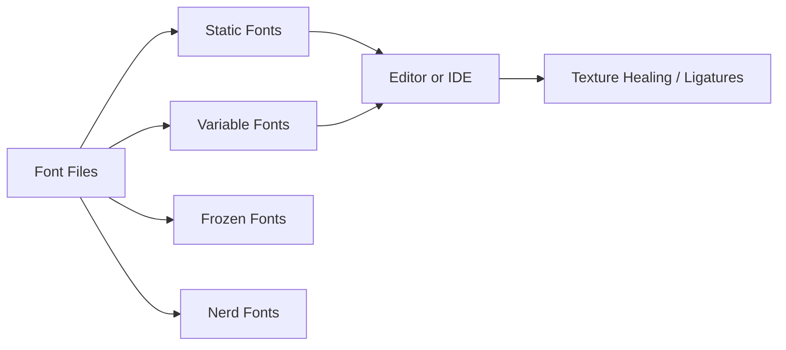

# githubnext/monaspace

> Cinq polices à chasse fixe compatibles entre elles, pour coder avec ligatures et « texture healing ».

## Le problème
Une police monospace unique rend le code uniforme et fatigant à lire ; peu proposent de mélanger des voix typographiques sans casser l'alignement.

## Ce que ça fait vraiment
Cinq familles (Neon, Argon, Xenon, Radon, Krypton) aux métriques identiques, en formats statique, variable, Nerd Fonts et « Frozen ». Les fonctions OpenType (`calt` pour la texture healing, `liga`, `ss01`–`ss10`, `cvNN`) s'activent dans l'éditeur. La version Frozen les fige pour les IDE qui n'exposent pas ces réglages.

## Comment c'est branché


## Essayer
```bash
bash util/install_macos.sh
brew install --cask font-monaspace
fc-cache -f
```
VS Code : `"editor.fontFamily": "'Monaspace Neon', monospace"` et `"editor.fontLigatures": "'calt', 'liga', 'ss01'…"`.

## Coût et pièges
Gratuit. Après mise à jour, il faut supprimer les anciennes polices, réinstaller, redémarrer les applications (parfois la machine). Le comportement des ligatures a changé entre versions mineures.

## Ce que ce n'est pas
Pas un outil logiciel : aucune exécution, aucun service. VS Code ne gère pas bien les polices variables ni le mélange de familles (README). Certaines icônes Nerd Fonts peuvent mal s'afficher selon le terminal.

## Alternatives
Aucune alternative nommée dans le README (Cascadia Code n'est cité que comme base des icônes Nerd Fonts).

## Pour toi
Utile en confort de lecture du code dans l'éditeur, sans rapport avec un travail data/IA : à ignorer comme sujet de veille, à installer si tu aimes les ligatures.

