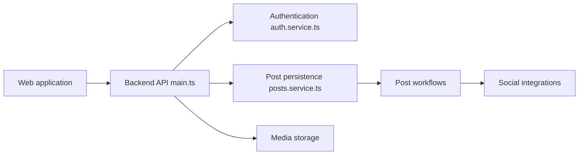

# gitroomhq/postiz-app

> Self-hostable tool for scheduling social media posts and tracking their analytics.

## The problem
Scheduling and tracking posts across several networks from a single place, with team collaboration.

## What it actually does
Post editor, calendar, analytics, collaboration, public API, n8n/Make/Zapier integration, MCP and CLI. Stack: pnpm monorepo, NextJS, NestJS, Prisma (PostgreSQL), Temporal, Resend. The AI features require your own keys when self-hosting.

## How it is wired

## Trying it
No command in the README (it points to an external Quick Start Guide; Docker/Coolify/Railway deployment is mentioned).

## Cost and gotchas
Cloud: subscription with a 7-day trial. Self-hosted: free, but Postgres, Redis, storage, one developer app per network (Meta/YouTube/TikTok approval can take up to several weeks) and AI keys are on you.

## What it is not
Not a data/AI tool. Self-hosting includes no uptime, backups or updates: all of it is on you. AGPL-3.0: network copyleft.

## Alternatives
No alternative named in the README (only a comparison with Postiz Cloud).

## For you
Ignore: a marketing tool unrelated to a data/AI/MLOps profile, and heavy to self-host.
