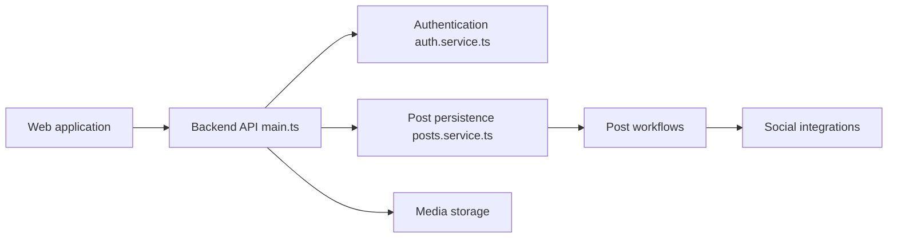

# gitroomhq/postiz-app

> Outil de planification et d'analytics de publications sur les réseaux sociaux, hébergeable soi-même.

## Le problème
Programmer et suivre des publications sur plusieurs réseaux depuis un seul endroit, avec travail d'équipe.

## Ce que ça fait vraiment
Éditeur de posts, calendrier, analytics, collaboration, API publique, intégration n8n/Make/Zapier, MCP et CLI. Pile : monorepo pnpm, NextJS, NestJS, Prisma (PostgreSQL), Temporal, Resend. Les fonctions IA demandent tes propres clés en auto-hébergement.

## Comment c'est branché

## Essayer
Aucune commande dans le README (renvoi vers un Quick Start Guide externe ; déploiement Docker/Coolify/Railway cité).

## Coût et pièges
Cloud : abonnement avec essai de 7 jours. Auto-hébergé : gratuit, mais Postgres, Redis, stockage, applis développeur par réseau (validation Meta/YouTube/TikTok jusqu'à plusieurs semaines) et clés IA à ta charge.

## Ce que ce n'est pas
Pas un outil data/IA. L'auto-hébergement n'inclut ni uptime, ni sauvegardes, ni mises à jour : tout est à ta charge. AGPL-3.0 : copyleft réseau.

## Alternatives
Aucune alternative nommée dans le README (comparaison avec Postiz Cloud seulement).

## Pour toi
À ignorer : outil marketing sans rapport avec un profil data/IA/MLOps, et lourd à auto-héberger.

