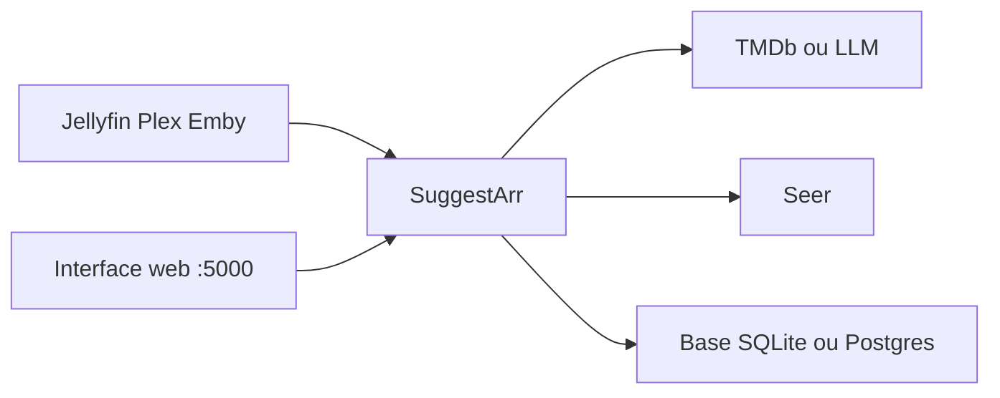

# giuseppe99barchetta/SuggestArr

> Service that automatically recommends and requests titles from Seer based on Jellyfin, Plex or Emby history.

## The problem
Feeding your home media library by hand based on what household members watch is tedious.

## What it actually does
It reads watch history (Jellyfin, Plex, Emby, optional Trakt and Simkl), finds similar titles via TMDb or an OpenAI-compatible LLM, then sends the requests to Seer. Web interface with scheduling, approval and cleanup of requests, SQLite, PostgreSQL or MySQL database, REST API.

## How it is wired
Simplified diagram based on the sheet, no diagram provided.



## Trying it
```bash
docker compose up -d
```
With the compose file from the README (image `ciuse99/suggestarr:latest`), then open http://localhost:5000.

## Cost and gotchas
TMDb key required. An OpenAI-compatible LLM is optional and billed by its provider. You must already have Seer and a media server.

## What it is not
Not a download tool: it only creates requests in Seer. Useless without this ecosystem.

## Alternatives
No alternative named in the README.

## For you
Ignore: media homelab tool, outside data, AI or MLOps topics, unless you already run this stack at home.
