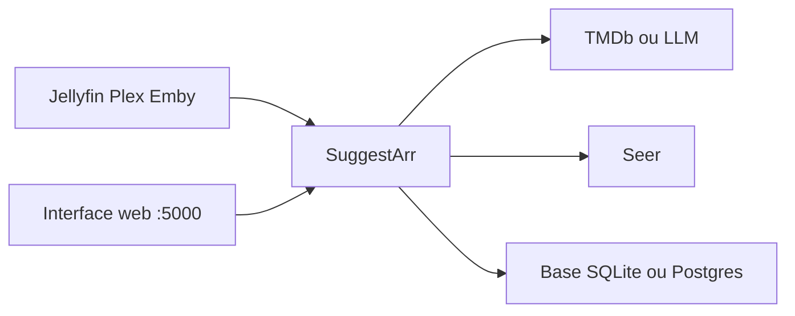

# giuseppe99barchetta/SuggestArr

> Service qui recommande et demande automatiquement des titres à Seer selon l'historique Jellyfin, Plex ou Emby.

## Le problème
Alimenter sa médiathèque domestique à la main d'après ce que regardent les membres du foyer est fastidieux.

## Ce que ça fait vraiment
Il lit l'historique de visionnage (Jellyfin, Plex, Emby, option Trakt et Simkl), trouve des titres proches via TMDb ou un LLM compatible OpenAI, puis envoie les demandes à Seer. Interface web avec planification, approbation et nettoyage des demandes, base SQLite, PostgreSQL ou MySQL, API REST.

## Comment c'est branché
Schéma simplifié d'après la fiche, sans diagramme fourni.



## Essayer
```bash
docker compose up -d
```
Avec le fichier compose du README (image `ciuse99/suggestarr:latest`), puis ouvrir http://localhost:5000.

## Coût et pièges
Clé TMDb obligatoire. Un LLM compatible OpenAI est facultatif et facturé par son fournisseur. Il faut déjà avoir Seer et un serveur multimédia.

## Ce que ce n'est pas
Pas un outil de téléchargement : il ne fait que créer des demandes dans Seer. Inutile sans cet écosystème.

## Alternatives
Aucune alternative nommée dans le README.

## Pour toi
À ignorer : outil de homelab multimédia, hors des sujets data, IA ou MLOps, sauf si tu as déjà cette pile chez toi.

