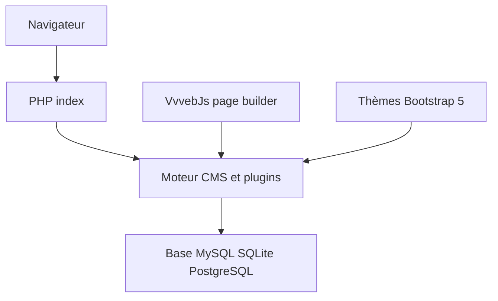

# givanz/Vvveb

> PHP CMS with a drag-and-drop page editor, for sites, blogs and online shops.

## The problem
Setting up a site or shop often requires a heavy CMS. This one aims for a small footprint and a built-in visual editor.

## What it actually does
A multisite, multilingual CMS with e-commerce (one-page checkout, subscriptions, variants, coupons), a marketplace of themes and plugins, backups, import/export. It also works as a headless CMS via GraphQL and REST. Runs with MySQL, MariaDB, SQLite or PostgreSQL, and a single exposed PHP file.

## How it is wired
Simplified diagram based on the fiche, no diagram provided.



## Trying it
```bash
git clone --recurse-submodules https://github.com/givanz/Vvveb
./build.sh
php cli.php install module=index host=127.0.0.1 user=root password=1234 database=vvveb admin[email]=admin@vvveb.com admin[password]=admin engine=mysqli
```

## Cost and gotchas
Free, PHP 7.4 hosting minimum (8.3 recommended) and a database to plan for. The README uses `admin` as an example password: change it. About a hundred open issues.

## What it is not
Not a data or AI tool. The README stresses speed without giving any measurement.

## Alternatives
No alternative named in the README.

## For you
Ignore: a general-purpose web CMS, off-topic for a data, AI or MLOps profile, and run by a single maintainer.
